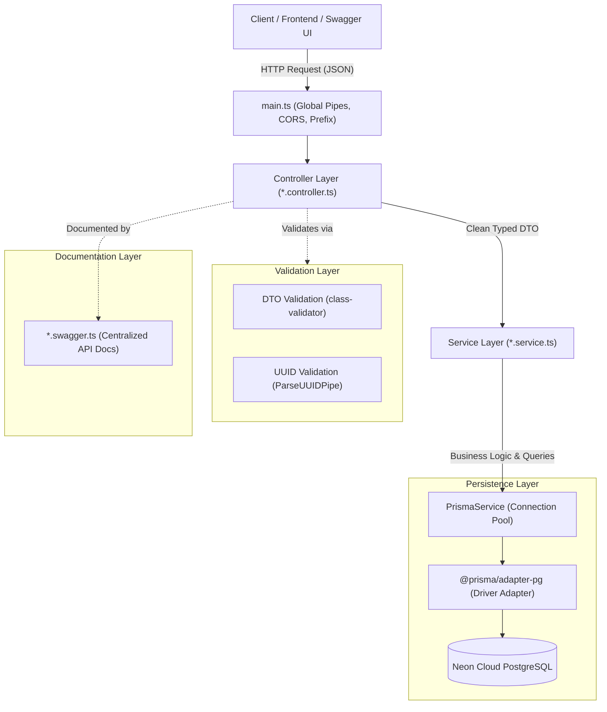

<div align="center">
  <h1>🎫 Ticket Help Desk API</h1>
  <p><strong>A Production-Ready, Enterprise-Grade Backend Architecture built with NestJS, Prisma 7 & Neon PostgreSQL</strong></p>

  <p>
    
    
    
    
    
  </p>
</div>

---

## 🌟 Why is this Project a 10/10 Benchmark for Learning NestJS?

Most NestJS tutorials teach basic tutorials with hardcoded arrays or cluttered controllers full of decorators. **This project was architected from Day 1 using true senior-level engineering principles.**

Even though the feature scope is clean and focused (Users & Support Tickets), the **underlying architecture is 100% production-ready and enterprise-scale**.

### 🏆 8 Senior-Level Architectural Highlights:

1. **Clean Architecture & Separation of Concerns (SoC):**
   - **DTOs (`dto/`):** Pure request validation (`class-validator`), type transformation (`class-transformer`), and payload schema documentation.
   - **Controllers (`*.controller.ts`):** 100% clean traffic routing and parameter extraction. Zero business logic, zero raw database calls.
   - **Services (`*.service.ts`):** The application brain containing all business decisions, database queries, and structured exception throwing.
   - **Documentation (`*.swagger.ts`):** Swagger response codes, summaries, and descriptions are completely isolated to eliminate **"Decorator Hell"** in controllers.

2. **Cutting-Edge Prisma 7 + Driver Adapter Architecture:**
   - Powered by `@prisma/client: ^7.x` and `@prisma/adapter-pg: ^7.x`.
   - Uses real PostgreSQL connection pooling (`pg.Pool`) configured for **Neon Serverless PostgreSQL**.
   - Decoupled configuration via `prisma.config.ts`, completely eliminating outdated connection parameters from schema files.

3. **Multi-File Prisma Schemas (`prisma/schema/`):**
   - Breaks away from the junior anti-pattern of putting 50+ models into one massive `schema.prisma`.
   - Feature-based schema files: `user.prisma`, `ticket.prisma`, and `schema.prisma` for clean domain modeling.

4. **Database Performance Indexing:**
   - Critical lookup columns (`status`, `priority`, `userId`, `createdAt`) are optimized with **PostgreSQL B-Tree Indexes** (`@@index`).
   - Ensures sub-millisecond query execution even with millions of tickets.

5. **Automated Database Seeding:**
   - Native Prisma seeding engine (`prisma/seed.ts` via `tsx`).
   - Re-creates initial roles (`ADMIN`, `AGENT`), test accounts, and baseline tickets with a single command: `npm run seed`.

6. **Strict TypeScript & Windows Polling Watcher:**
   - Configured with senior-grade strictness flags: `noUncheckedIndexedAccess: true`, `strict: true`.
   - Preserves Nest's `emitDecoratorMetadata` while adding `watchOptions` polling to eliminate dropped file-save events on Windows.

7. **Graceful Shutdown & Pool Lifecycle:**
   - Uses NestJS `enableShutdownHooks()`.
   - On server termination, `PrismaService` cleanly runs `this.$disconnect()` and `pool.end()`, preventing connection leaks on Neon DB.

8. **Bulletproof Input & Parameter Validation:**
   - Global `ValidationPipe` with `whitelist: true` (strips malicious injected payload properties) and `forbidNonWhitelisted: true`.
   - Uses `ParseUUIDPipe` to automatically reject malformed ticket IDs before they touch the database.

---

## 🏛️ System Architecture Flow



---

## 📂 Project Directory Structure

```text
ticket-help-desk/
├── prisma/
│   ├── schema/                      # Multi-file Prisma 7 Schemas
│   │   ├── schema.prisma            # Datasource & Client generator configuration
│   │   ├── user.prisma              # User model & Role enums
│   │   └── ticket.prisma            # Ticket model, Status & Priority enums + Indexes
│   └── seed.ts                      # Automated database seed script
│
├── src/
│   ├── config/
│   │   └── swagger.config.ts        # Centralized Swagger/OpenAPI setup
│   │
│   ├── prisma/
│   │   ├── prisma.service.ts        # Neon DB connection pool with lifecycle management
│   │   └── prisma.module.ts         # Global database module (@Global)
│   │
│   ├── user/
│   │   ├── dto/
│   │   │   └── create-user.dto.ts   # User input validation rules
│   │   ├── user.controller.ts       # User HTTP endpoint handlers
│   │   ├── user.service.ts          # User persistence & business logic
│   │   ├── user.swagger.ts          # Isolated Swagger documentation for User
│   │   └── user.module.ts           # User feature module
│   │
│   ├── tickets/
│   │   ├── dto/
│   │   │   ├── create-ticket.dto.ts # Ticket creation payload validation
│   │   │   ├── update-ticket.dto.ts # Partial update validation
│   │   │   └── ticket-query.dto.ts  # Pagination, filters, search & sorting query DTO
│   │   ├── tickets.controller.ts    # Ticket route handlers (UUID validated)
│   │   ├── tickets.service.ts       # Ticket CRUD, parallel pagination count & checks
│   │   ├── tickets.swagger.ts       # Isolated Swagger documentation for Tickets
│   │   └── tickets.module.ts        # Ticket feature module
│   │
│   ├── app.module.ts                # Root application dependency graph
│   └── main.ts                      # Lean bootstrap entry point
│
├── .env                             # Environment secrets (DATABASE_URL, PORT)
├── nest-cli.json                    # Nest CLI config (spec generation disabled)
├── package.json                     # Scripts & modern dependencies
├── prisma.config.ts                 # Prisma 7 configuration file
└── tsconfig.json                    # Strict TypeScript with hot-reload polling
```

---

## 🗄️ Database Schema & Domain Model

### User Model
| Field | Type | Attributes | Description |
| :--- | :--- | :--- | :--- |
| `id` | `Int` | `@id @default(autoincrement())` | Primary Key |
| `name` | `String` | | Full name of the user |
| `email` | `String` | `@unique` | Unique email address |
| `role` | `Role` | `@default(USER)` | `USER`, `AGENT`, `ADMIN` |
| `tickets` | `Ticket[]` | | Relation (One-to-Many) |

### Ticket Model
| Field | Type | Attributes | Description |
| :--- | :--- | :--- | :--- |
| `id` | `String` | `@id @default(uuid())` | Primary Key (UUID v4) |
| `subject` | `String` | | Title / Subject (5 - 150 chars) |
| `description` | `String` | | Detailed issue description |
| `status` | `TicketStatus` | `@default(OPEN)` | `OPEN`, `IN_PROGRESS`, `CLOSED` |
| `priority` | `TicketPriority`| `@default(MEDIUM)` | `LOW`, `MEDIUM`, `HIGH` |
| `userId` | `Int` | `Foreign Key` | Creator of the ticket |
| `createdAt` | `DateTime` | `@default(now())` | Indexed for fast sort |
| `updatedAt` | `DateTime` | `@updatedAt` | Automatic update timestamp |

---

## 🚀 API Endpoints Overview

All routes are versioned under the global prefix: **`/api/v1`**

### Users Module
| Method | Route | Description | Status Codes |
| :--- | :--- | :--- | :--- |
| `GET` | `/api/v1/user` | Get all users with their tickets | `200` |
| `POST`| `/api/v1/user` | Register a new user | `201`, `400`, `409` |

### Tickets Module
| Method | Route | Description | Status Codes |
| :--- | :--- | :--- | :--- |
| `POST` | `/api/v1/tickets` | Create a support ticket linked to a user | `201`, `400`, `404` |
| `GET` | `/api/v1/tickets` | Paginated ticket list with search & filters | `200` |
| `GET` | `/api/v1/tickets/:id`| Get ticket details by UUID | `200`, `400`, `404` |
| `PATCH`| `/api/v1/tickets/:id`| Partially update ticket (status/priority) | `200`, `400`, `404` |
| `DELETE`|`/api/v1/tickets/:id`| Permanently delete a ticket | `200`, `400`, `404` |

#### Supported Query Parameters for `GET /api/v1/tickets`:
- `page` (default: 1)
- `limit` (default: 10, max: 100)
- `status` (`OPEN`, `IN_PROGRESS`, `CLOSED`)
- `priority` (`LOW`, `MEDIUM`, `HIGH`)
- `userId` (Filter by specific creator)
- `search` (Search across subject & description)
- `sortBy` (`createdAt`, `updatedAt`, `priority`, `status`, `subject`)
- `sortOrder` (`asc`, `desc`)

---

## 🛠️ Getting Started & Installation

### 1. Prerequisites
- [Node.js](https://nodejs.org/) (v20+ or v22+ recommended)
- A free [Neon Database](https://neon.tech) PostgreSQL connection string.

### 2. Clone & Install Dependencies
```bash
git clone <your-repo-url>
cd ticket-help-desk
npm install --legacy-peer-deps
```

### 3. Configure Environment Variables
Create a `.env` file in the root directory:
```env
PORT=3000
DATABASE_URL="postgresql://<user>:<password>@<neon-host>/<database>?sslmode=require"
```

### 4. Sync Database Schema & Seed Data
```bash
# Push schema to Neon cloud database
npm run push

# Populate initial Admin, Agent, and Sample Tickets
npm run seed
```

### 5. Start the Development Server
```bash
npm run start:dev
```

### 6. Interactive Documentation & Testing
Open your browser and navigate to:
👉 **[http://localhost:3000/docs](http://localhost:3000/docs)**

---

## 📈 Enterprise Scaling Roadmap: Taking this to the Next Level

Because this codebase follows strict modular patterns, you can scale it into a full enterprise platform with minimal friction:

1. **Authentication & Authorization:**
   - Add `AuthModule` with JWT, Passport, and Refresh tokens.
   - Use NestJS `@Roles('ADMIN', 'AGENT')` and Guards to protect sensitive ticket mutations.
2. **Background Jobs & Queues (BullMQ + Redis):**
   - Automatically email agents or customers when ticket status changes using background workers.
3. **Caching Layer:**
   - Add Redis caching interceptor on `GET /api/v1/tickets` for sub-10ms response times.
4. **File Attachments:**
   - Add S3 / Cloudflare R2 bucket integration for screenshots and logs attached to tickets.
5. **Microservices Migration:**
   - Because `UserModule` and `TicketsModule` are completely decoupled, they can be extracted into standalone microservices via RabbitMQ or gRPC within hours.

---

## 👨‍💻 Developer & License
Crafted with passion for clean software architecture and modern NestJS practices.  
License: [MIT](LICENSE)
